# DZ Beauty Pro

**Business management system for beauty salons in Algeria.**
Appointments, cashier and receipts, client debts, staff commissions and salaries, daily dashboard and backups: in one offline app for Windows and Android, in Arabic and French.

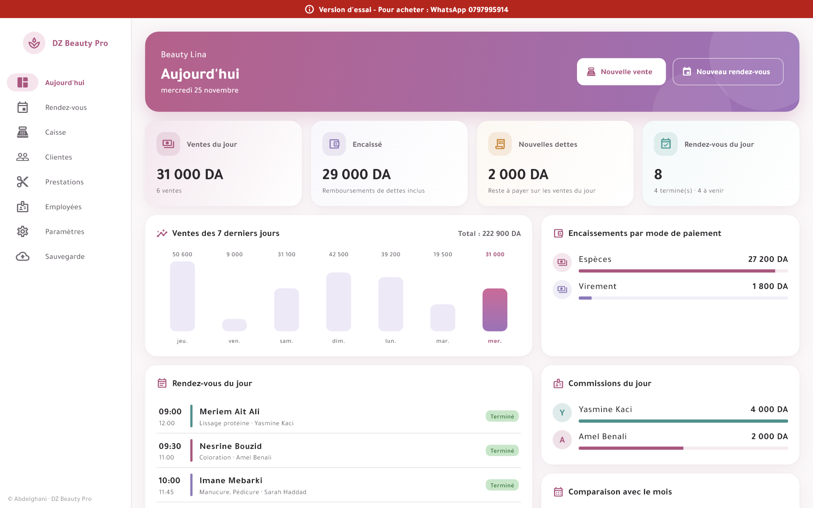

  <b>291</b> automated tests &nbsp;·&nbsp; <b>2</b> platforms (Windows, Android) &nbsp;·&nbsp; <b>2</b> languages (Arabic RTL, French) &nbsp;·&nbsp; <b>100%</b> offline

> All screenshots are taken from the real application running in its **demo edition**, with the sample salon "Beauty Lina" and fictitious data.

---

## Gallery

| | Arabic (RTL) | French |
|---|---|---|
| **Today dashboard** | 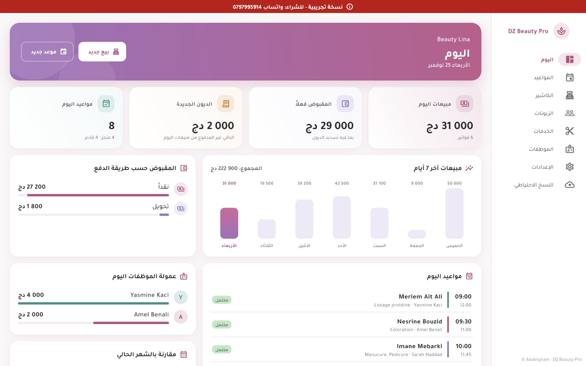 |  |
| **Appointments** — day schedule, one column per staff member | 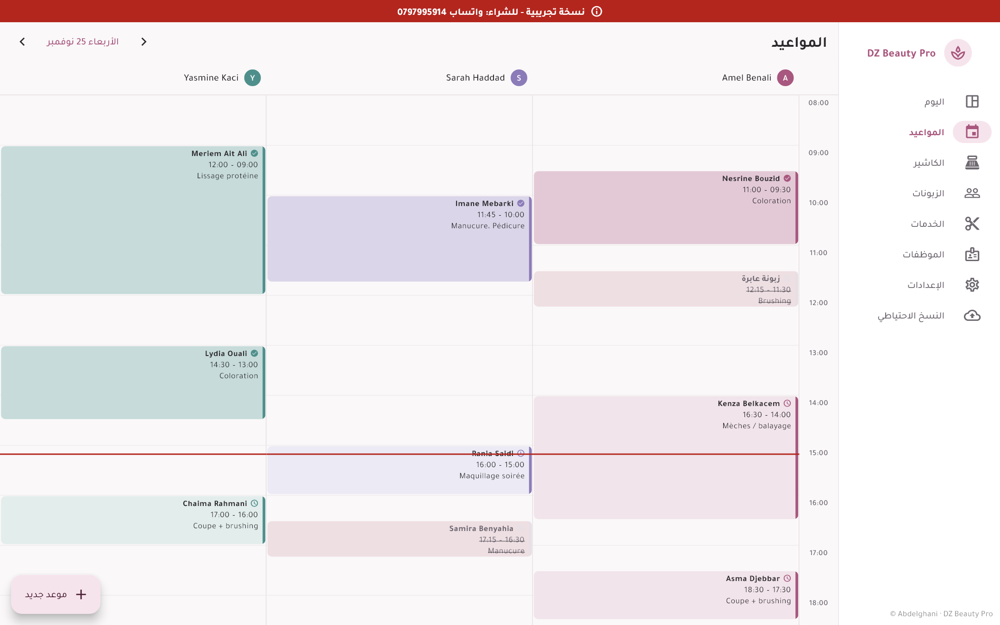 | 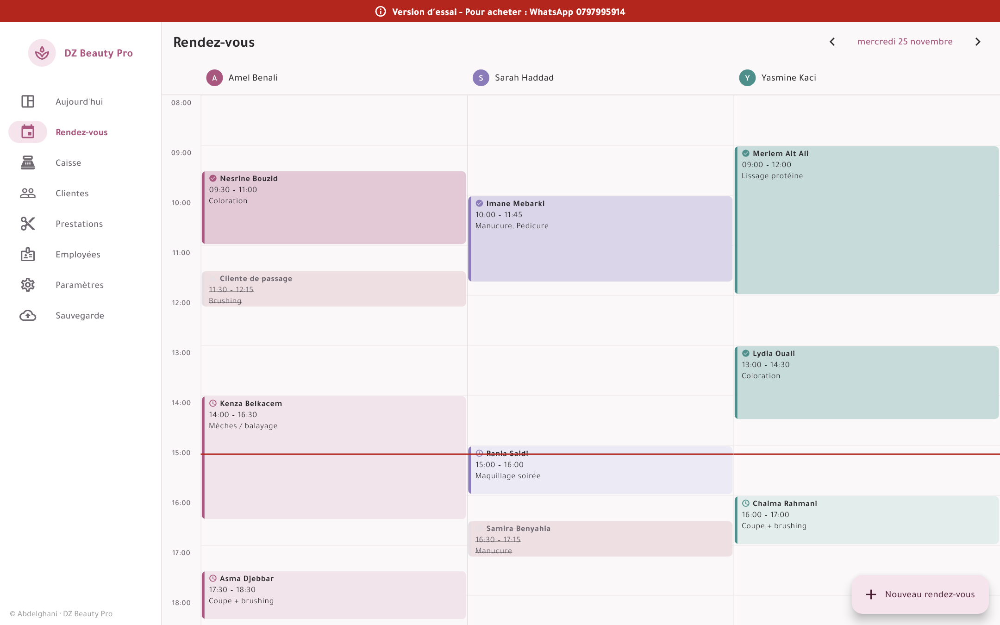 |
| **Cashier** — checkout prefilled from an appointment | 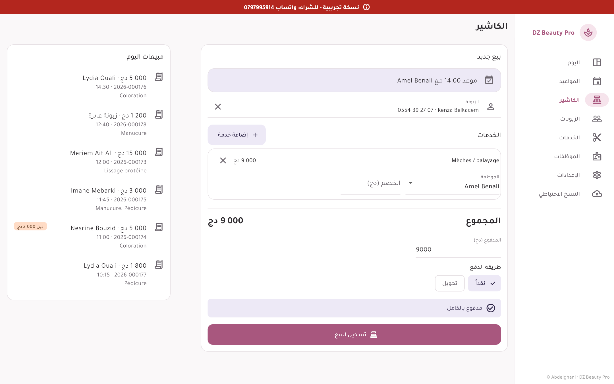 | 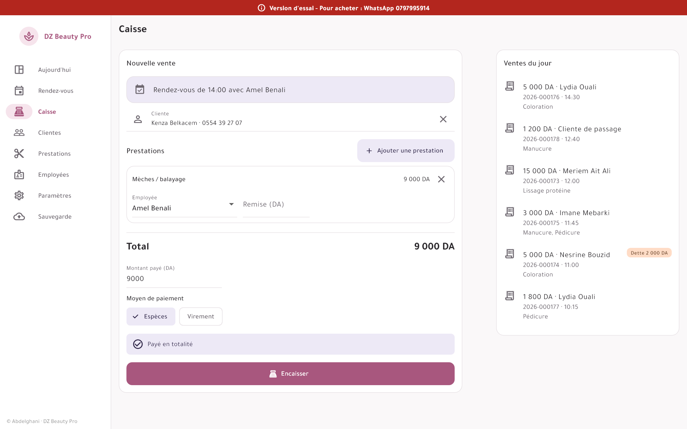 |
| **Receipt** — print, or share as an image | 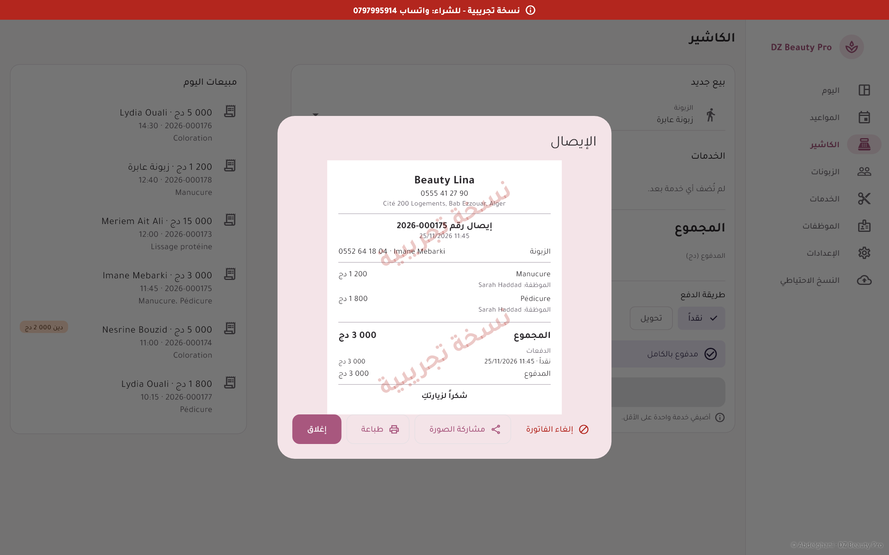 | 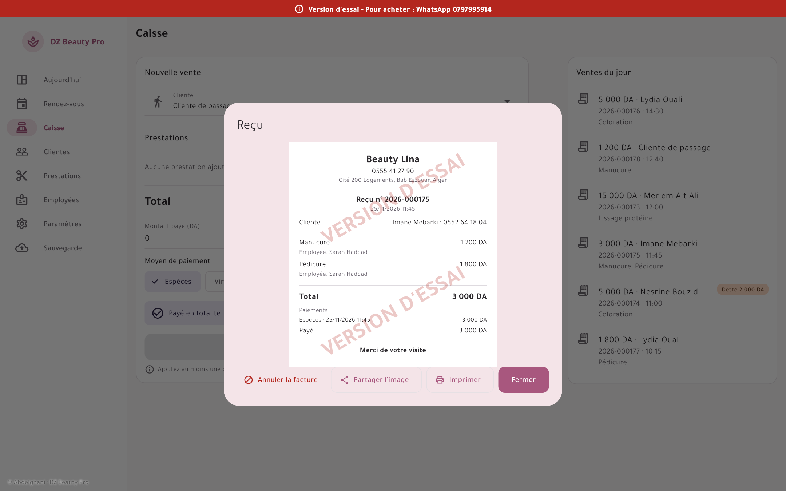 |
| **Staff account** — commissions, salary, advances, payments | 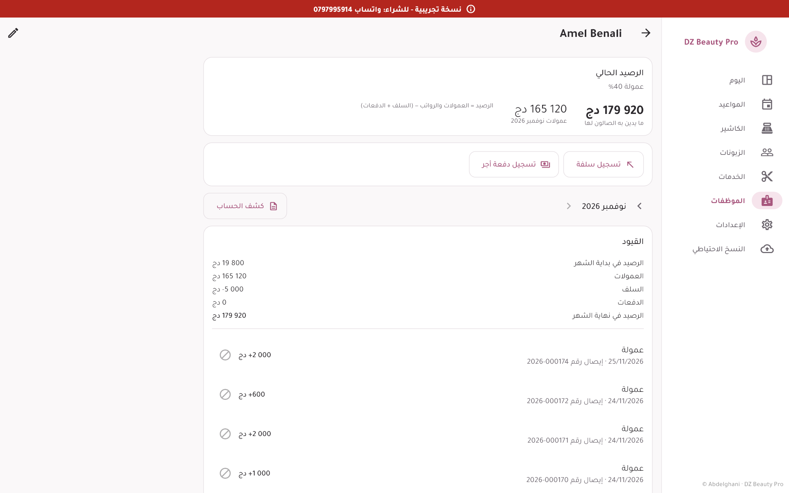 | 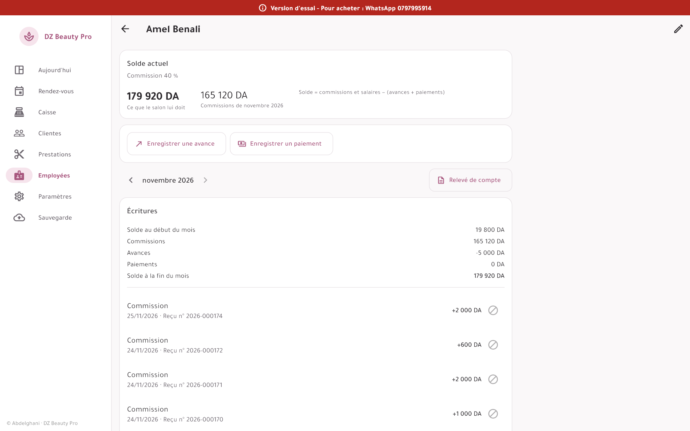 |
| **Backup & restore** | 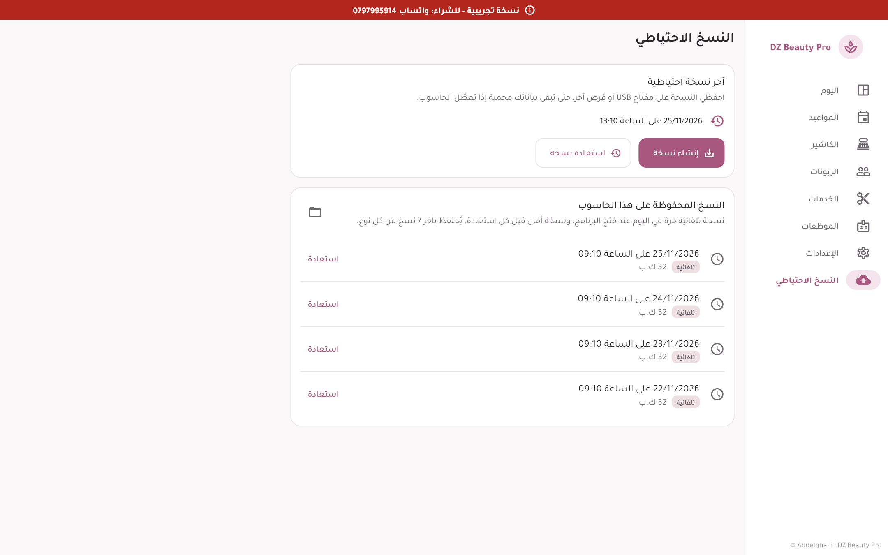 | 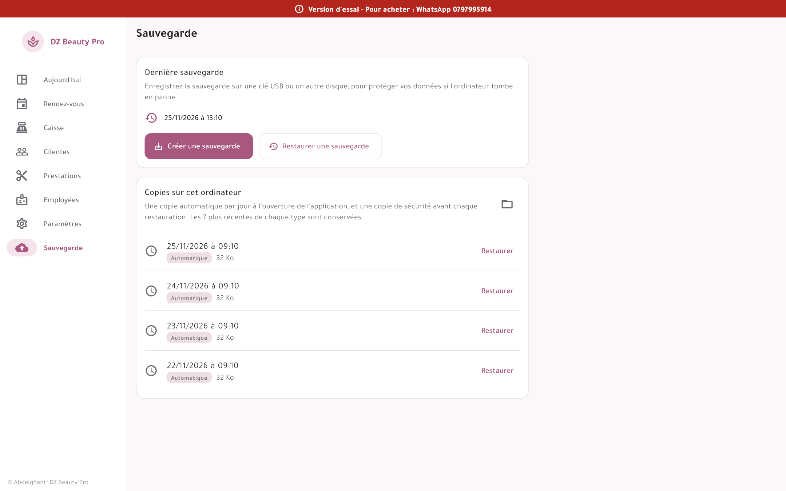 |

### Responsive layout (phone)

The same app adapts to the screen: a side navigation rail on desktop and tablet, a bottom bar on phones.

  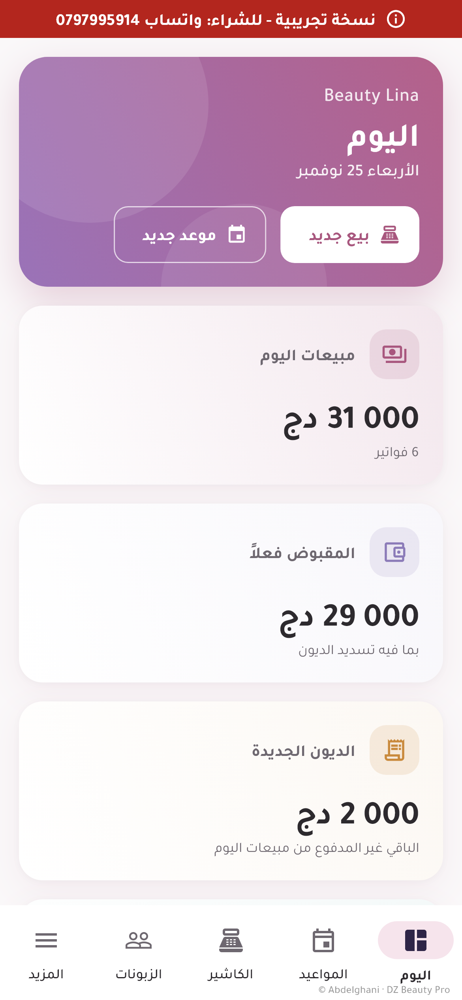
  &nbsp;&nbsp;
  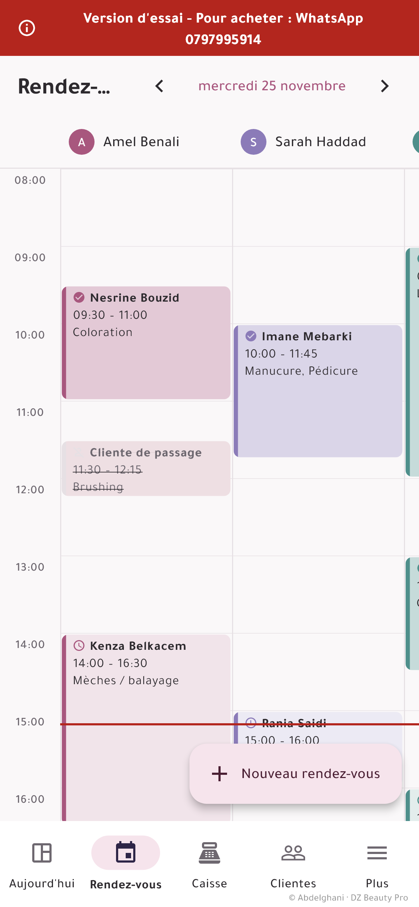

---

## The problem

Most beauty salons in Algeria still run on a paper notebook and memory:

- **Appointments** collide, and nobody sees at a glance which staff member is free.
- **Staff pay** mixes commission percentages, fixed salaries and cash advances, so calculating it at the end of the month leads to disputes.
- **Clients often pay in part.** Debts are forgotten, or nobody can prove them.
- **There is no daily picture** of what was sold, what was actually collected and what is still owed.
- Internet access is unreliable, and owners will not trust their data to a server they do not control.

## What DZ Beauty Pro does

- **Today dashboard**: sales, money actually collected (debt repayments included), new debts, appointments done and upcoming, 7-day sales chart, takings per payment method, commissions per staff member and a comparison with the month so far.
- **Appointments**: a day planner with one column per staff member and a "now" line. Overlapping bookings are refused, each service is checked against the staff members qualified for it, and appointments are tracked as booked, completed, cancelled or no-show.
- **Cashier**: turns an appointment into a sale in one step. Supports discounts per line, partial payments, several payment methods, debt repayment and voiding an invoice with a reason.
- **Receipts**: numbered per year, printed on thermal paper (58/80 mm) or A4, or shared as an image (WhatsApp) with Arabic text shaped correctly.
- **Clients**: contact details, visit and purchase history, and the debt still owed.
- **Staff ledger**: commission, fixed salary or mixed pay plans; advances and payments; monthly statements; and a running balance showing what the salon owes each person.
- **Service catalog**: prices, durations, and which staff members can perform each service.
- **Backup and restore**: an automatic copy every day, manual backups to a USB drive, and a restore that is checked before it replaces anything.
- **Two editions from one codebase**: a demo edition with sample data, a banner and watermarked receipts, and a full edition with a first-run setup wizard. Each ships as a Windows installer.

---

## Tech stack

| Area | Technology |
|---|---|
| UI framework | **Flutter** (Material 3), adaptive layouts for phone, tablet and desktop |
| Language | **Dart** |
| Database | **Drift** on **SQLite**: typed queries, reactive streams, versioned schema |
| State management | **Riverpod** |
| Navigation | **go_router**, one navigation stack per section |
| Printing & documents | **pdf** / **printing** for receipts and staff statements |
| Localization | Flutter's official internationalization (ARB files): Arabic and French |
| Targets | Windows (desktop installer), Android (phone & tablet) |

## Architecture

The code is organized in strict layers. Each layer only talks to the one below it.

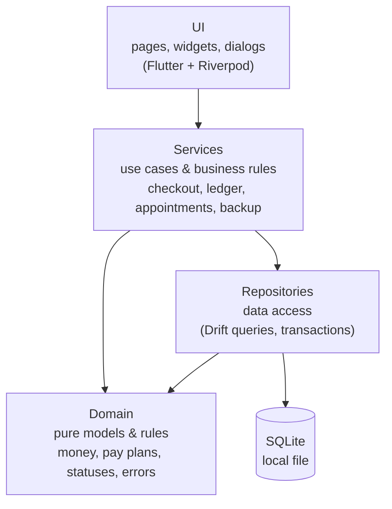

- **UI** never touches the database. It watches reactive streams and calls services.
- **Services** hold the business rules, for example "a booked slot cannot overlap another one" or "a voided invoice reverses its commissions".
- **Domain** is plain Dart with no dependency on Flutter or the database. It is easy to unit test.
- **Repositories** are the only layer that writes SQL, and they wrap every multi-step change in a transaction.

---

## Key technical decisions

**Money is stored as whole integers.**
Every amount is kept in the smallest unit as an integer and never as a floating-point number. Totals, discounts, commission percentages and balances therefore never drift by a fraction, and an accounting report always adds up to the last dinar.

**Commissions are frozen on each sale line.**
When a sale is made, each line records the commission rate and amount in force at that moment. If an owner changes a staff member's percentage next month, past sales and past statements do not change, so history stays exactly as it was paid.

**Records are archived, never deleted.**
Staff members, services, clients and payment methods that are no longer used are archived. They disappear from day-to-day lists but stay attached to old sales and statements. An invoice is voided with a reason instead of being erased, and voiding it reverses its commissions. Nothing that money depends on can vanish.

**Every multi-step change runs in a transaction.**
A checkout writes the sale, its lines, its payments, the commissions and the link to the appointment in one atomic operation. A crash or power cut leaves either all of it or none of it.

**Schema migrations are versioned.**
The database schema has gone through 6 versions. Each version is captured as a snapshot, and every upgrade path is tested automatically. Existing salons therefore upgrade in place without losing data.

**Backups use `VACUUM INTO`, with integrity checks.**
A backup is a consistent snapshot of the live database, taken safely even while the app is writing, and packaged with a manifest. Before a restore, the file is fully verified: archive format, manifest, SQLite integrity check, required tables and schema version. A safety copy of the current data is then made before anything is replaced. A damaged or foreign file is rejected and leaves the current data untouched.

**Right-to-left is supported from the start.**
Arabic is the default language, and the whole interface mirrors correctly: navigation, charts, the planner and receipts. Numbers, phone numbers and amounts stay readable in mixed Arabic and French text. Receipts are rendered with Flutter's own text engine, so Arabic letters are joined and shaped correctly in printed and shared images.

**It works fully offline.**
The app needs no internet connection, account or server. All data lives in a single local database file that belongs to the salon. Backups go to a folder or USB drive the owner chooses.

**Quality**
291 automated tests cover business rules, the database and migrations, backup and restore, and full-screen UI flows at phone and desktop sizes in both languages. Static analysis reports no issues.

---

## Source code

The source code is **private**: DZ Beauty Pro is a commercial product.
I am happy to walk through the code, the architecture and the tests during an interview, on request.

## Contact

- **GitHub:** [@abdelghani-me](https://github.com/abdelghani-me)

---

### بالعربية

**DZ Beauty Pro** نظام تسيير تجاري لصالونات التجميل في الجزائر. يدير المواعيد والكاشير والإيصالات وديون الزبونات وعمولات الموظفات ورواتبهن، ويعرض لوحة يومية، ويحفظ نسخاً احتياطية. يعمل بدون إنترنت على Windows وAndroid، بالعربية والفرنسية. الكود المصدري خاص لأنه منتج تجاري، ويمكن عرضه في مقابلة عند الطلب.

### En français

**DZ Beauty Pro** est un logiciel de gestion pour les salons de beauté en Algérie. Il gère les rendez-vous, la caisse et les reçus, les dettes des clientes, les commissions et salaires des employées, le tableau de bord du jour et les sauvegardes. Il fonctionne sans internet sur Windows et Android, en arabe et en français. Le code source est privé, car il s'agit d'un produit commercial ; il peut être présenté lors d'un entretien, sur demande.

---

Copyright © 2026 Abdelghani. All rights reserved.

